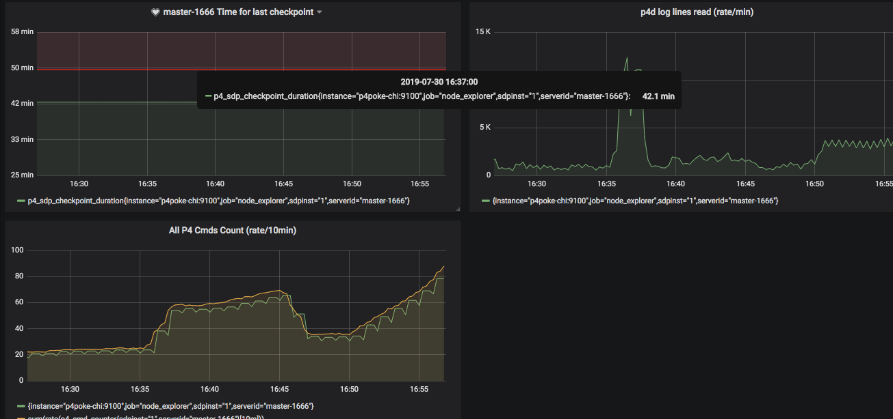
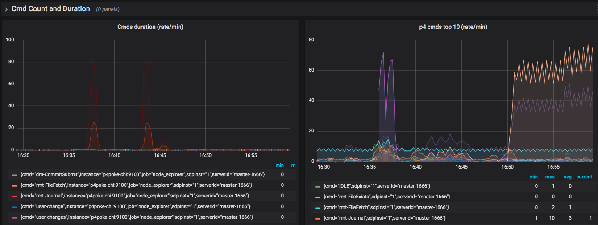
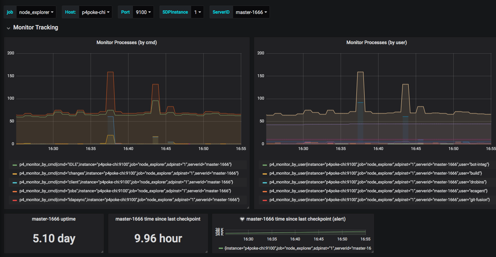
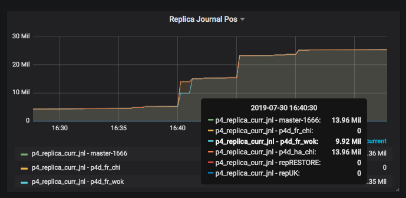
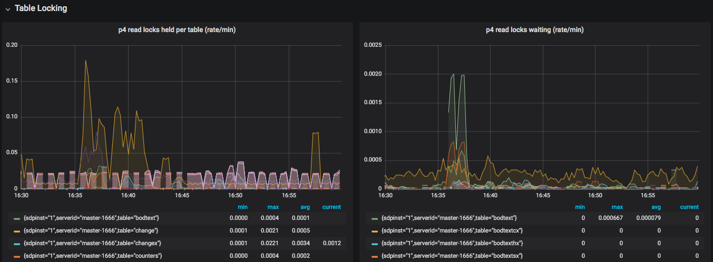

= Perforce P4Prometheus - Overview
Perforce Professional Services <consulting@perforce.com>
:revnumber: v2026.1
:revdate: 2026-11-27
:doctype: book
:icons: font
:toc:
:toclevels: 5
:sectnumlevels: 4
:xrefstyle: full

image:https://img.shields.io/badge/Support-Community-yellow.svg[Support]

== Preface

P4Prometheus integrates Perforce Helix Core Server (`p4d`) with https://prometheus.io/[Prometheus] and related monitoring tools. It collects real-time metrics from `p4d` logs, `p4 monitor`, and related sources, then exposes them for Prometheus collection and Grafana dashboards. The metrics can also drive system alerting.

The `p4prometheus` service continuously parses `p4d` logs and writes Prometheus textfile-collector metrics. Other project components interrogate `p4d` and associated logs for supplementary metrics.

:sectnums:
== Overview

P4Prometheus is part of a monitoring solution comprising these components:

* https://prometheus.io/[Prometheus]: time-series metrics management.
* https://github.com/VictoriaMetrics/VictoriaMetrics[VictoriaMetrics]: recommended, Prometheus-compatible long-term metrics storage.
* https://grafana.com/[Grafana]: metrics dashboards and visualization.
* https://github.com/prometheus/node_exporter[node_exporter]: Linux host metrics and textfile collection.
* https://github.com/prometheus-community/windows_exporter[windows_exporter]: Windows host metrics.
* https://github.com/prometheus/alertmanager[Alertmanager]: alert routing, grouping, and de-duplication.
* https://github.com/rcowham/pint[Pint]: Prometheus alerting rules linter - fork of Cloudflare original.

In addition to these components you can create a monitoring solution tailored to your environment, with automation and alerting including:

* Alerts being sent to Slack (or Teams/Email/PagerDuty)
** Such alerts containing links to relevant Grafana dashboards, and a Runbook for incident response, help ensure timely and effective handling of incidents.
** Options for alerting include notifications of blocked commands, and automated updates when blocks reduce
* Monitoring of Memory usage, and optional OOM-kill events (Out-Of-Memory killer) on Linux hosts.

Project components:

* link:../releases/latest[p4prometheus]: a binary that parses P4 Server logs.
* link:../cmd/p4metrics/README.md[p4metrics]: supplementary P4 Server and SDP-compatible metrics.
* link:../scripts/monitor_locks.py[monitor_locks.py] and link:../scripts/p4monitor_locks.sh[p4monitor_locks.sh]: Linux lock monitoring using `lslocks` and `p4 monitor show`.
* link:../cmd/p4logtail/README.md[p4logtail] and link:../cmd/p4plogtail/README.md[p4plogtail]: completed-command log tails with JSON output (for use with third party log analysis tools such as Splunk, DataDog, ELK Stack etc.)

P4Prometheus uses https://github.com/rcowham/go-libp4dlog[go-libp4dlog] for p4d log parsing.

The installation and upgrade scripts support standard installation, dedicated data volumes (`-d /data`), offline assets (`--local-tarballs-dir`), SDP-safe configuration in `/p4/common/site/config/`, hostname-specific HMS fleet configuration, and stateful non-destructive upgrades. See link:P4Prometheus_Installation.adoc[the installation guide] for details.

https://prometheus.io/docs/introduction/overview/[Prometheus overview]

image:https://prometheus.io/assets/docs/architecture.svg[Prometheus architecture]

== Support Status

This is a Community Supported Perforce tool.

== Installation

Use the automated scripts for new installations and upgrades. The canonical guide is link:P4Prometheus_Installation.adoc[P4Prometheus Installation].

It covers monitoring-server, P4 Server, and node-exporter-only installations; upgrades; dedicated data volumes; air-gapped installations; state files; and manual component installation where scripts cannot be used.

== Grafana Dashboards

When configured, Grafana dashboards provide command, replication, lock, and host-level views.

.Commands Summary

.Command Rates and Durations

.Active Commands

.Replication Status

.Read and Write Locks

Grafana dashboards can define alerts; Alertmanager processes their notifications. The installation guide includes setup and validation guidance, and link:P4_RunbookAlertHandling.adoc[Runbook Alert Handling] provides a customizable operational runbook.

== Metrics Available

All principal metrics carry `serverid` and, for SDP installations, `sdpinst` labels. The README remains the exhaustive metric-name reference: link:../README.md#metrics-available[metrics available].

=== p4prometheus Metrics

The primary log parser reports command throughput, active commands, resource use, synchronization activity, command error counts, command durations, and lock wait/held time.

[cols="1,2",options="header"]
|===
|Metric family |Examples

|Parser health and throughput
|`p4_prom_log_lines_read`, `p4_prom_cmds_processed`, `p4_prom_cmds_pending`

|Command activity
|`p4_cmd_running`, `p4_cmd_counter`, `p4_cmd_cumulative_seconds`

|Resource use
|`p4_prom_cpu_user`, `p4_prom_cpu_system`, `p4_prom_memory`

|Command dimensions
|`p4_cmd_user_counter`, `p4_cmd_ip_counter`, `p4_cmd_replica_counter`, `p4_cmd_program_counter`

|Command cost (optional)
|`p4_cmd_cost_cumulative`, `p4_cmd_user_cost_cumulative`

|Rate-limit errors
|`p4_cmd_rate_limit_errors`, `p4_cmd_max_cost_errors`

|Lock timings
|`p4_total_read_wait_seconds`, `p4_total_read_held_seconds`, `p4_total_write_wait_seconds`, `p4_total_write_held_seconds`
|===

If you are running p4d 2026.2 or later, command cost metrics are available.
Set `output_cmd_cost_by_cmd` and/or `output_cmd_cost_by_user` to `true` in
the p4prometheus configuration to enable these counters. Both default to
`false`; per-user metrics create a series for each user. The counters sum
positive command costs recorded in the log since the collector started.
Commands without a cost field do not contribute, and the parser cannot
distinguish a missing cost from zero.

The rate-limit counters count logged CostThreshold/MaxCommands refusals and
MaxCost terminations, including retries. `output_rate_limit_errors_by_cmd`
defaults to `true`, enabling per-command breakdowns for both types. Set
`output_rate_limit_errors_by_user` to `true` to enable per-user breakdowns;
it defaults to `false` because it may create many series. If the log cannot
associate an error with a user or command, the
corresponding label is `(unknown)`. Counters reset when the collector restarts.

=== p4metrics Metrics

`p4metrics` replaces the legacy `monitor_metrics.sh` metrics while retaining compatible names and labels. It reports active processes, memory, server identity and uptime, replication, journal/log rotation, license state, SDP job results, Swarm status, and optional memory-limit enforcement.

[cols="1,2",options="header"]
|===
|Metric family |Examples

|Process monitoring
|`p4_monitor_by_cmd`, `p4_monitor_by_prog`, `p4_monitor_by_state`, `p4_monitor_by_user`, `p4_monitor_max_cmd_time`

|Memory and limits
|`p4_active_memory_by_cmd`, `p4_active_memory_by_user`, `p4_memlimit_kill_candidates`, `p4_memlimit_kills_total`

|Replication
|`p4_pull_queue_total`, `p4_pull_replica_lag`, `p4_pull_replication_error`

|Server and license
|`p4_server_uptime`, `p4_p4d_build_info`, `p4_license_expires`, `p4_licensed_user_count`

|SDP jobs and logs
|`p4_sdp_checkpoint_error`, `p4_sdp_verify_errors`, `p4_journal_size`, `p4_log_size`

|Swarm
|`p4_swarm_error`, `p4_swarm_tasks`, `p4_swarm_workers`, `p4_swarm_version`
|===

`p4_monitor_by_prog{prog}` counts monitor-table entries by client program. The
text " (brokered)" is removed from program names. It is enabled by default;
set `cmds_by_prog: false` in the p4metrics configuration to disable it.

=== Lock Metrics

Linux lock monitoring requires `lslocks`. `p4monitor_locks.sh` invokes `monitor_locks.py`, which relates operating-system locks to `p4 monitor show` results. It reports:

* `p4_locks_db_read` and `p4_locks_db_write`
* `p4_locks_cliententity_read` and `p4_locks_cliententity_write`
* `p4_locks_meta_read` and `p4_locks_meta_write`
* `p4_locks_cmds_blocked`

The detailed lock-monitoring installation and troubleshooting information is in link:P4Prometheus_Installation.adoc[P4Prometheus Installation].

== Related Tools

* link:../cmd/p4logtail/README.md[p4logtail]
* link:../cmd/p4plogtail/README.md[p4plogtail]
* link:../cmd/p4erroranalyzer/README.md[p4erroranalyzer]
* link:../cmd/logresourcepressure/[logresourcepressure]

== Metrics Details

The following table lists the HELP text for metrics emitted by the collectors,
sorted by metric name. Metrics are conditional on the relevant collector,
configuration option, or P4D capability being enabled. P4D realtime metric
names are generated from keys returned by `p4d --show-realtime`; the
`p4_rtv_<field>` row documents their common HELP format.

[cols="1,3",options="header"]
|===
|Metric |HELP

|`p4_active_memory_by_cmd`
|Active memory in bytes used by monitor processes running cmd (all states)

|`p4_active_memory_by_user`
|Active memory in bytes used by monitor processes running as user (all states)

|`p4_auth_ssl_cert_expires`
|P4D Auth SSL certificate expiry epoch seconds

|`p4_auth_version`
|P4 Auth Svc version string

|`p4_change_counter`
|P4D change counter

|`p4_cmd_cost_cumulative`
|Cumulative command cost (by cmd)

|`p4_cmd_counter`
|A count of completed p4 cmds (by cmd)

|`p4_cmd_cpu_system_cumulative_seconds`
|The total in system CPU seconds (by cmd)

|`p4_cmd_cpu_user_cumulative_seconds`
|The total in user CPU seconds (by cmd)

|`p4_cmd_cumulative_seconds`
|The total in seconds (by cmd)

|`p4_cmd_error_counter`
|A count of cmd errors (by cmd)

|`p4_cmd_ip_counter`
|A count of completed p4 cmds (by IP)

|`p4_cmd_ip_cumulative_seconds`
|The total in seconds (by IP)

|`p4_cmd_max_cost_errors`
|The number of commands terminated for exceeding MaxCost

|`p4_cmd_max_cost_errors_by_cmd`
|MaxCost terminations by cmd

|`p4_cmd_max_cost_errors_by_user`
|MaxCost terminations by user

|`p4_cmd_mem_mb`
|The total of cmd memory usage (in MB)

|`p4_cmd_mem_peak_mb`
|The peak total of cmd memory usage (in MB)

|`p4_cmd_program_counter`
|A count of completed p4 cmds (by program)

|`p4_cmd_program_cumulative_seconds`
|The total in seconds (by program)

|`p4_cmd_rate_limit_errors`
|The number of commands refused by CostThreshold or MaxCommands rate limits

|`p4_cmd_rate_limit_errors_by_cmd`
|Rate-limit refusals by cmd

|`p4_cmd_rate_limit_errors_by_user`
|Rate-limit refusals by user

|`p4_cmd_replica_counter`
|A count of completed p4 cmds (by broker/replica/proxy)

|`p4_cmd_replica_cumulative_seconds`
|The total in seconds (by broker/replica/proxy)

|`p4_cmd_running`
|The number of running commands at any one time (deprecated use p4_cmds_running instead)

|`p4_cmd_user_cost_cumulative`
|Cumulative command cost (by user)

|`p4_cmd_user_counter`
|A count of completed p4 cmds (by user)

|`p4_cmd_user_cumulative_seconds`
|The total in seconds (by user)

|`p4_cmd_user_detail_counter`
|A count of completed p4 cmds (by user and cmd)

|`p4_cmd_user_detail_cumulative_seconds`
|The total in seconds (by user and cmd)

|`p4_cmds_fatal_errors`
|The number of commands exited with server fatal error

|`p4_cmds_paused`
|The number of (resource pressure) paused commands at any one time

|`p4_cmds_paused_cumulative`
|Total time of commands paused due to resource pressure (seconds)

|`p4_cmds_paused_max`
|The max number of (resource pressure) paused commands since last metric

|`p4_cmds_running`
|The number of running commands at any one time

|`p4_cmds_running_max`
|The max number of running commands at any one time since last metric

|`p4_errors_count`
|P4D error count by subsystem and level

|`p4_filesys_min`
|Minimum space for filesystem

|`p4_journal_records_count`
|P4JOURNAL record count by table and action (rv/pv/dv)

|`p4_journal_size`
|Size of P4JOURNAL in bytes

|`p4_journals_rotated`
|Count of rotations of P4JOURNAL by p4metrics

|`p4_lbr_binary_checkins`
|The number of Lbr Binary Checkins for commands

|`p4_lbr_binary_closes`
|The number of Lbr Binary closes for commands

|`p4_lbr_binary_copies`
|The number of Lbr Binary Copies for commands

|`p4_lbr_binary_digests`
|The number of Lbr Binary Digests for commands

|`p4_lbr_binary_exists`
|The number of Lbr Binary exists for commands

|`p4_lbr_binary_filesizes`
|The number of Lbr Binary FileSizes for commands

|`p4_lbr_binary_modtimes`
|The number of Lbr Binary ModTimes for commands

|`p4_lbr_binary_opens`
|The number of Lbr Binary opens for commands

|`p4_lbr_binary_readbytes`
|The number of Lbr Binary ReadBytes for commands

|`p4_lbr_binary_reads`
|The number of Lbr Binary Reads for commands

|`p4_lbr_binary_writebytes`
|The number of Lbr Binary WriteBytes updated in workspaces by syncs

|`p4_lbr_binary_writes`
|The number of Lbr Binary Writes updated in workspaces by syncs

|`p4_lbr_compress_checkins`
|The number of Lbr Compress Checkins for commands

|`p4_lbr_compress_closes`
|The number of Lbr Compress Closes for commands

|`p4_lbr_compress_copies`
|The number of Lbr Compress Copies for commands

|`p4_lbr_compress_digests`
|The number of Lbr Compress Digests for commands

|`p4_lbr_compress_exists`
|The number of Lbr Compress Exists for commands

|`p4_lbr_compress_filesizes`
|The number of Lbr Compress FileSizes for commands

|`p4_lbr_compress_modtimes`
|The number of Lbr Compress ModTimes for commands

|`p4_lbr_compress_opens`
|The number of Lbr Compress Opens for commands

|`p4_lbr_compress_readbytes`
|The number of Lbr Compress ReadBytes for commands

|`p4_lbr_compress_reads`
|The number of Lbr Compress Reads for commands

|`p4_lbr_compress_writebytes`
|The number of Lbr Compress WriteBytes for commands

|`p4_lbr_compress_writes`
|The number of Lbr Compress Writes for commands

|`p4_lbr_rcs_checkins`
|The number of Lbr Rcs Checkins for commands

|`p4_lbr_rcs_closes`
|The number of Lbr Rcs closes for commands

|`p4_lbr_rcs_copies`
|The number of Lbr Rcs Copies for commands

|`p4_lbr_rcs_digests`
|The number of Lbr Rcs Digests for commands

|`p4_lbr_rcs_exists`
|The number of Lbr Rcs exists for commands

|`p4_lbr_rcs_filesizes`
|The number of Lbr Rcs FileSizes for commands

|`p4_lbr_rcs_modtimes`
|The number of Lbr Rcs ModTimes for commands

|`p4_lbr_rcs_opens`
|The number of Lbr Rcs opens for commands

|`p4_lbr_rcs_readbytes`
|The number of Lbr Rcs ReadBytes for commands

|`p4_lbr_rcs_reads`
|The number of Lbr Rcs Reads for commands

|`p4_lbr_rcs_writebytes`
|The number of Lbr Rcs WriteBytes updated in workspaces by syncs

|`p4_lbr_rcs_writes`
|The number of Lbr Rcs Writes updated in workspaces by syncs

|`p4_lbr_uncompress_checkins`
|The number of Lbr Uncompress Checkins for commands

|`p4_lbr_uncompress_closes`
|The number of Lbr Uncompress Closes for commands

|`p4_lbr_uncompress_copies`
|The number of Lbr Uncompress Copies for commands

|`p4_lbr_uncompress_digests`
|The number of Lbr Uncompress Digests for commands

|`p4_lbr_uncompress_exists`
|The number of Lbr Uncompress Exists for commands

|`p4_lbr_uncompress_filesizes`
|The number of Lbr Uncompress FileSizes for commands

|`p4_lbr_uncompress_modtimes`
|The number of Lbr Uncompress ModTimes for commands

|`p4_lbr_uncompress_opens`
|The number of Lbr Uncompress Opens for commands

|`p4_lbr_uncompress_readbytes`
|The number of Lbr Uncompress ReadBytes for commands

|`p4_lbr_uncompress_reads`
|The number of Lbr Uncompress Reads for commands

|`p4_lbr_uncompress_writebytes`
|The number of Lbr Uncompress WriteBytes for commands

|`p4_lbr_uncompress_writes`
|The number of Lbr Uncompress Writes for commands

|`p4_license_IP`
|P4D Licensed IP

|`p4_license_expires`
|P4D License expiry (epoch secs)

|`p4_license_info`
|P4D License info

|`p4_license_last_success_timestamp_seconds`
|Last successful P4D license collection (epoch secs), or 0 if never collected

|`p4_license_support_expires`
|P4D License support expiry (epoch secs)

|`p4_license_time_remaining`
|P4D License time remaining (secs)

|`p4_licensed_user_count`
|P4D Licensed User count

|`p4_licensed_user_limit`
|P4D Licensed User Limit

|`p4_locks_cliententity_read`
|clientEntity read locks

|`p4_locks_cliententity_write`
|clientEntity write locks

|`p4_locks_cmds_blocked`
|cmds blocked by locks

|`p4_locks_db_read`
|Database read locks

|`p4_locks_db_write`
|Database write locks

|`p4_locks_meta_read`
|meta db read locks

|`p4_locks_meta_write`
|meta db write locks

|`p4_log_size`
|Size of P4LOG in bytes

|`p4_login_error`
|P4 monitoring login error

|`p4_logs_file_count`
|Count of files in SDP logs directory

|`p4_logs_rotated`
|Count of rotations of P4LOG by p4metrics

|`p4_memlimit_kill_candidates`
|Number of processes exceeding memory limits

|`p4_memlimit_kills_total`
|Total number of processes killed by memlimit enforcement

|`p4_monitor_by_cmd`
|P4 running processes by cmd in monitor table

|`p4_monitor_by_prog`
|P4 processes by program in monitor table

|`p4_monitor_by_state`
|P4 running processes by state in monitor table

|`p4_monitor_by_user`
|P4 running processes by user in monitor table

|`p4_monitor_cmds`
|P4 running processes count grouped by command patterns

|`p4_monitor_cmds_max_runtime`
|P4 running processes max runtime (seconds) grouped by command patterns

|`p4_monitor_cmds_runtime`
|P4 running processes total runtime (seconds) grouped by command patterns

|`p4_monitor_max_cmd_time`
|P4 monitor max (non-svc) command run time

|`p4_monitoring_up`
|P4 monitoring initialised and working

|`p4_p4d_build_info`
|P4D Version/build info

|`p4_p4d_server_type`
|P4D server type/services

|`p4_p4metrics_version`
|P4Metrics version

|`p4_pause_rate_cpu`
|The (resource pressure) pause rate for CPU

|`p4_pause_rate_mem`
|The (resource pressure) pause rate for Mem

|`p4_pause_state_cpu`
|The (resource pressure) pause state for CPU (0-2)

|`p4_pause_state_mem`
|The (resource pressure) pause state for Mem (0-2)

|`p4_processes_count`
|P4 count of running processes (via ps)

|`p4_prom_build_info`
|Build info for p4prometheus

|`p4_prom_cmds_pending`
|A count of all current cmds (not completed)

|`p4_prom_cmds_processed`
|A count of all cmds processed

|`p4_prom_cpu_system`
|System CPU used by p4prometheus

|`p4_prom_cpu_user`
|User CPU used by p4prometheus

|`p4_prom_log_lines_read`
|A count of log lines read

|`p4_prom_memory`
|System memory used by p4prometheus (bytes)

|`p4_prom_svr_events_processed`
|A count of all server events processed

|`p4_proxy_bytes_total`
|Bytes transferred by source.

|`p4_proxy_command_duration_seconds_total`
|Sum of completed command lapse times in seconds.

|`p4_proxy_commands_completed_total`
|Number of completed commands observed in the p4p log.

|`p4_proxy_files_total`
|Files transferred by source.

|`p4_proxy_last_command_completion_timestamp_seconds`
|Unix timestamp of the most recently completed command.

|`p4_pull_error_count`
|Count of p4 pull transfers in failed state

|`p4_pull_queue_bytes`
|Count of p4 pull total bytes

|`p4_pull_queue_count`
|Count of p4 pull files (not in failed state)

|`p4_pull_queue_total`
|Count of p4 pull queue total files

|`p4_pull_replica_bytes_behind`
|Count of how many bytes behind replica is

|`p4_pull_replica_journals_behind`
|Count of how many journals behind replica is

|`p4_pull_replica_lag`
|Count of how many bytes behind replica is

|`p4_pull_replication_error`
|Set to 1 if replication error is true

|`p4_replica_curr_jnl`
|Current journal for server

|`p4_replica_curr_pos`
|Current offset within for server

|`p4_resource_terminations`
|The number of commands terminated because the server was low on resources

|`p4_rtv_<field>`
|P4 realtime metric `<rtv.name>`

|`p4_sdp_checkpoint_duration`
|Time taken for last checkpoint/restore action

|`p4_sdp_checkpoint_error`
|SDP checkpoint error detected (1=error, 0=ok)

|`p4_sdp_checkpoint_log_time`
|Time of last checkpoint log

|`p4_sdp_directory_file_count`
|Count of regular files in an SDP directory

|`p4_sdp_directory_file_count_by_age`
|Count of regular files in an SDP directory by age range

|`p4_sdp_directory_oldest_file_age_seconds`
|Age of the oldest regular file in an SDP directory in seconds

|`p4_sdp_directory_scan_success`
|Whether the SDP directory scan completed successfully

|`p4_sdp_directory_size_bytes`
|Total size of regular files in an SDP directory in bytes

|`p4_sdp_sync_replica_duration`
|Time taken for last sync replica run

|`p4_sdp_sync_replica_error`
|SDP sync replica error detected (1=error, 0=ok)

|`p4_sdp_sync_replica_log_time`
|Time of last sync replica log

|`p4_sdp_verify_duration`
|Duration of last p4verify.sh script run

|`p4_sdp_verify_errors`
|Count of verify errors in SDP p4verify.log

|`p4_sdp_verify_log_modtime`
|Time of modification of last SDP p4verify log

|`p4_sdp_version`
|SDP Version

|`p4_server_uptime`
|P4D Server uptime (seconds)

|`p4_ssl_cert_expires`
|P4D SSL certificate expiry epoch seconds

|`p4_swarm_authorized`
|Swarm API call authorized (1=yes or 0=no)

|`p4_swarm_error`
|Swarm error (0=no or 1=yes)

|`p4_swarm_future_tasks`
|Swarm future task queue size

|`p4_swarm_max_workers`
|Swarm current max number of workers

|`p4_swarm_tasks`
|Swarm current task queue size

|`p4_swarm_version`
|P4 Swarm version string

|`p4_swarm_workers`
|Swarm current number of workers

|`p4_sync_bytes_added`
|The number of bytes added to workspaces by syncs

|`p4_sync_bytes_updated`
|The number of bytes updated in workspaces by syncs

|`p4_sync_files_added`
|The number of files added to workspaces by syncs

|`p4_sync_files_deleted`
|The number of files deleted in workspaces by syncs

|`p4_sync_files_updated`
|The number of files updated in workspaces by syncs

|`p4_total_read_held_seconds`
|The total read locks held in seconds (by table)

|`p4_total_read_wait_seconds`
|The total waiting for read locks in seconds (by table)

|`p4_total_trigger_lapse_seconds`
|The total lapse time for triggers in seconds (by trigger)

|`p4_total_write_held_seconds`
|The total write locks held in seconds (by table)

|`p4_total_write_wait_seconds`
|The total waiting for write locks in seconds (by table)
|===
